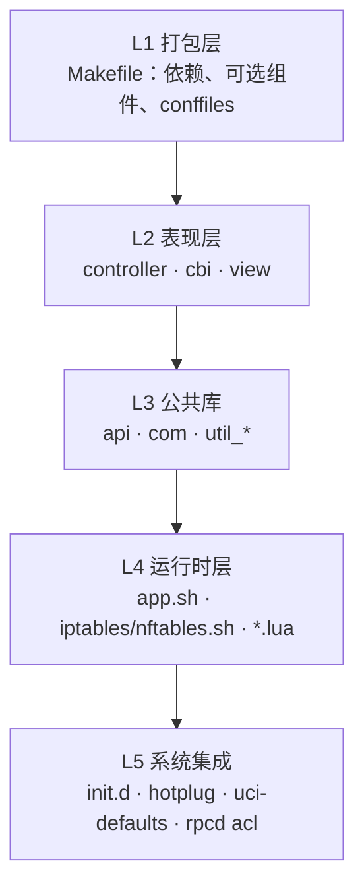
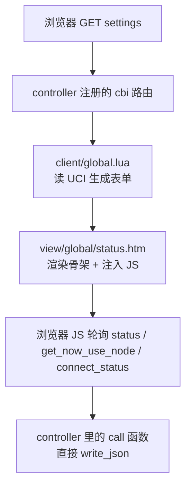
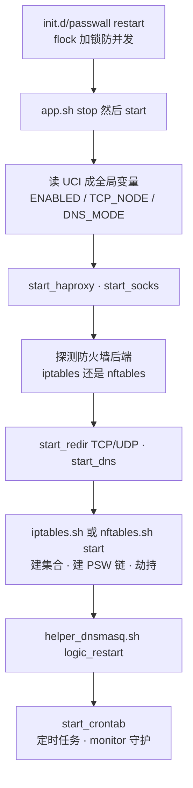
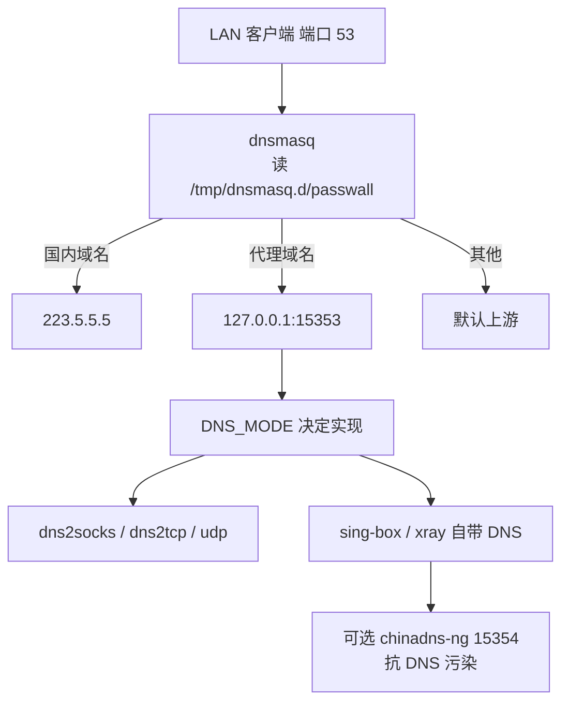
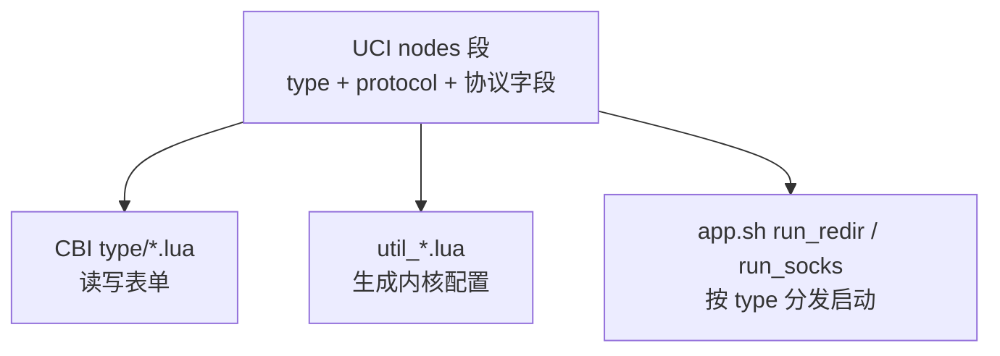
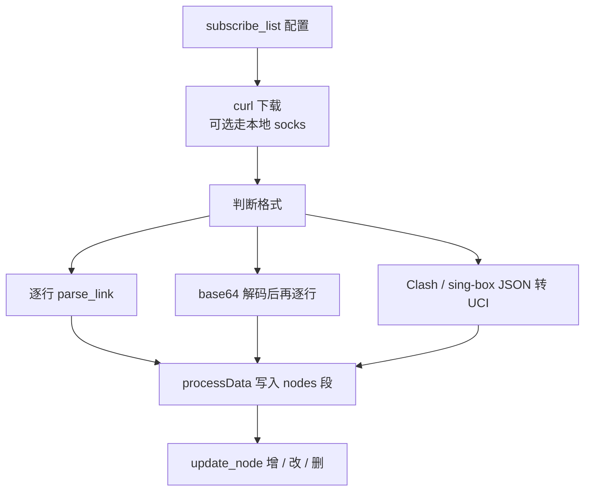
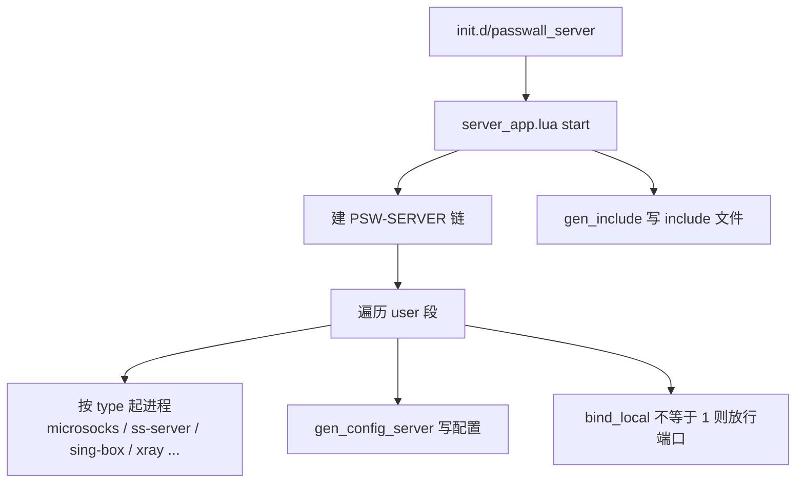
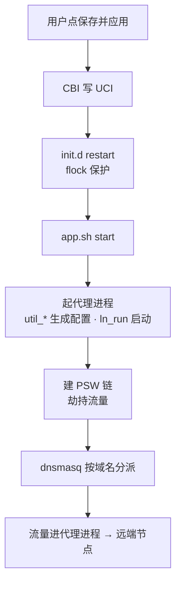

# PassWall 架构学习笔记

> 适用代码：`luci-app-passwall` v4.70-5
>
> 目标：从架构层面理解这个 App —— 它由哪些层组成、每层解决什么问题、每个文件负责什么、配置如何变成运行中的进程和防火墙规则。

[TOC]

## 一句话概括

PassWall 本质上是一个 ==配置 → 生成 → 执行== 的代理编排器：

- **LuCI（Web UI）** 只负责把用户的选择写进 **UCI 配置**（`/etc/config/passwall`）；
- **Shell / Lua 运行时** 负责把 UCI 翻译成 **进程**（sing-box / xray / ss-redir / chinadns-ng …）和 **配置文件**（JSON / YAML / conf）；
- **内核 netfilter（iptables 或 nftables）** 负责把 LAN 流量**劫持**到这些本地端口；
- **dnsmasq + 规则文件** 负责按域名 / IP 决定「走代理还是直连」。

理解了这条主线，整个项目 130 个文件就都能挂到这张网上了。

## 一、分层架构

整个包从下往上可以切成五层，每层只依赖下一层：



各层职责：

- **L1 打包层** —— `Makefile` 定义包名、版本、依赖和编译时可选的二进制组件，最后交给 `luci.mk`。
- **L2 表现层** —— 路由、表单、模板。==只读写 UCI，不直接操作进程==。
- **L3 公共库** —— 工具函数、组件元数据、各内核的配置生成器。CBI 与运行时脚本共用。
- **L4 运行时层** —— 真正的执行者：起进程、写配置、建防火墙规则、更新订阅与规则。
- **L5 系统集成** —— 启动脚本、热插拔、首次安装初始化、权限声明。

> [!IMPORTANT] 最关键的一条架构决策
> L2 与 L4 之间**没有直接调用**。它们唯一的契约就是 UCI 配置文件，加上少量 `lua -e` / `app.sh 子命令` 的命令行调用。这让 UI 和运行时可以各自演进 —— 也是这个项目最值得学的地方。

## 二、目录结构

```text
luci-app-passwall/
├── Makefile                 包定义（版本、依赖、可选组件）
├── po/                      国际化
├── luasrc/
│   ├── controller/passwall.lua      唯一路由入口
│   ├── model/cbi/passwall/
│   │   ├── client/                  客户端页面
│   │   │   ├── global.lua           基本设置
│   │   │   ├── node_list.lua        节点列表
│   │   │   ├── node_config.lua      节点详情（动态加载 type/）
│   │   │   ├── type/*.lua           11 种协议表单
│   │   │   ├── acl*.lua             访问控制
│   │   │   └── ...                  订阅 / 规则 / 分流 / 日志
│   │   └── server/                  服务端页面
│   ├── passwall/                    公共库
│   │   ├── api.lua                  工具函数 + 更新引擎
│   │   ├── com.lua                  组件元数据表
│   │   ├── server_app.lua           服务端启动器
│   │   └── util_*.lua               各内核配置生成器
│   └── view/passwall/               HTML 模板
└── root/                            映射到路由器根文件系统
    ├── etc/
    │   ├── init.d/passwall
    │   ├── init.d/passwall_server
    │   ├── hotplug.d/iface/98-passwall
    │   └── uci-defaults/luci-passwall
    └── usr/share/
        ├── rpcd/acl.d/luci-app-passwall.json
        └── passwall/
            ├── 0_default_config   出厂 UCI 配置
            ├── app.sh             总调度（1811 行）
            ├── iptables.sh        防火墙后端 A（1270 行）
            ├── nftables.sh        防火墙后端 B（1288 行）
            ├── helper_dnsmasq*    DNS 分流
            ├── subscribe.lua      订阅解析（1292 行）
            ├── rule_update.lua    规则更新（469 行）
            ├── monitor.sh         进程守护
            ├── test.sh            节点测速
            └── rules/             规则数据
```

## 三、文件职责速查

### 打包层

- **`Makefile`** —— 定义包 `luci-app-passwall`、版本 `4.70-5`、`LUCI_DEPENDS`（chinadns-ng、dns2socks、ipt2socks、microsocks、tcping…）。`Package/config` 段提供编译菜单：是否打包 Xray / sing-box / Hysteria / Trojan-Go / Brook / NaiveProxy，以及透明代理用 **iptables 还是 nftables**（按 `PACKAGE_firewall4` 自动二选一）。`conffiles` 声明升级时保留的配置文件。

> [!NOTE]
> 代理内核二进制**不在这里编译**，它们来自另一个仓库 `openwrt-passwall-packages`，本包只是 `select` 依赖。

### 控制器（唯一路由入口）

- **`controller/passwall.lua`** —— `index()` 里用 `entry()` 注册所有路由：CBI 页面、`call()` 型轻量接口（status、ping_node、set_node、update_rules…），以及循环 `com.lua` 动态生成的 `check_<组件>` / `update_<组件>`。此外实现 `reset_config`、`show_menu`、`link_add_node`、`copy_node`、`clear_all_nodes` 等动作型函数。

这是**理解菜单结构的钥匙**：想看某个页面背后是哪个文件，先在这里搜路径。

### 客户端页面

- **`client/global.lua`** —— 基本设置。挂载 `global/status.htm` 状态卡片；主开关、TCP/UDP 节点选择、代理模式（global / returnhome / chnroute / gfwlist）、DNS 模式、IPv6、分流节点。含 `redir_mode_validate` 等跨字段校验。
- **`client/node_list.lua`** —— 节点列表（`TypedSection "nodes"`）。`s.remove` 里会级联清理引用该节点的 socks 与自动切换备份列表。
- **`client/node_config.lua`** —— 节点详情页。**本身不含任何协议字段**，而是遍历 `type/` 目录，用 `loadfile()` + `setfenv()` 把每个协议模块注入同一个 section —— 这就是「协议插件化」的落点。
- **`client/type/*.lua`** —— 11 个协议表单：`ss / ss-rust / ssr / trojan-plus / trojan-go / ray(Xray) / sing-box / brook / hysteria / naive / tuic`。每个文件先判断二进制是否存在（`api.is_finded`），不存在直接 `return`；然后注册自己的类型名，最后调用 `api.luci_types()` 完成字段前缀重写。
- **`client/node_subscribe.lua`** / **`node_subscribe_config.lua`** —— 订阅列表 / 单条订阅配置（URL、更新周期、过滤关键词、节点上限）。
- **`client/acl.lua`** / **`acl_config.lua`** —— 访问控制：按源 IP / MAC / IP 段 / ipset 匹配，为不同设备指定不同节点、代理模式、DNS。
- **`client/rule.lua`** / **`rule_list.lua`** —— 规则源管理（chnroute / gfwlist / chnlist / geoip / geosite 的下载地址）与规则内容编辑。
- **`client/shunt_rules.lua`** —— 分流规则，配合 `_shunt` 类型节点使用。
- **`client/socks_config.lua`** —— 额外 Socks 服务（对外暴露本地代理端口），含故障自动切换。
- **`client/haproxy.lua`** —— 多节点负载均衡（`haproxy_config` 段）。
- **`client/other.lua`** —— 日志级别、启动延时、持久化日志路径等杂项。注册时带 `{autoapply = true}`，保存即 commit。
- **`client/app_update.lua`** / **`client/log.lua`** —— 组件更新页 / 日志查看页（后者用 `form()` 而非 `cbi()`）。

### 服务端页面

- **`server/index.lua`** —— 服务端总开关。
- **`server/user.lua`** —— 用户列表：每个用户 = 一个端口 + 一种协议 + 密码/UUID。
- **`server/type/*.lua`** —— 各协议的服务端参数。

### 公共库

- **`api.lua`** —— 全项目最核心的工具箱：
  - 路径与版本：`get_app_path`、`get_app_version`（带 md5 缓存）、`compare_versions`、`auto_get_arch`
  - 网络判定：`is_ip` / `is_ipv6` / `is_mac` / `iprange` / `parseURL`
  - UCI 便捷读：`uci_get_type` / `uci_get_type_id`
  - 节点展示：`get_valid_nodes` / `get_node_remarks`（拼成 `Xray VLESS：[备注]`）
  - 下载更新三件套：`to_check` → `to_download` → `to_extract` → `to_move`
  - `luci_types()`：把 `ss_address` 这类带前缀字段，在「当前 type == SS」时透明映射到无前缀的 `address`
- **`com.lua`** —— 组件注册表。每项给出 `repo`、`get_url`、`cmd_version`、`default_path`、`match_fmt_str`、`file_tree`。**新增一个可自动更新的内核，只需在这里加一项。**
- **`util_xray.lua`** / **`util_sing-box.lua`** —— 配置生成器，对外三个入口：`gen_config()`（客户端主配置）、`gen_config_server()`（服务端）、`gen_proto_config()`（仅生成「本地 socks/http → 远端协议」的最小配置）。
- **`util_shadowsocks.lua`** / **`util_trojan.lua`** / **`util_hysteria.lua`** / **`util_tuic.lua`** / **`util_naiveproxy.lua`** —— 同上，只是目标格式换成各自内核的 JSON / YAML。
- **`server_app.lua`** —— 服务端启动器：读 `passwall_server` 的 `user` 段，为每个用户起进程、写配置、加放行规则。

### 视图模板

- **`view/global/status.htm`** —— 首页状态卡片，用 `XHR.get()` 轮询 `status` / `connect_status` / `get_now_use_node`，显示当前节点、运行状态、延迟。
- **`view/global/footer.htm`** —— 底部「保存并应用 / 重启」按钮组。
- **`view/node_list/link_add_node.htm`** —— 粘贴 `ss://`、`vmess://` 等分享链接直接建节点。
- **`view/node_list/link_share_man.htm`** —— 节点详情页顶部的分享链接生成器（1097 行，反向把 UCI 节点拼成 URI）。
- **`view/log/log.htm`** / **`view/app_update/app_version.htm`** / **`view/rule/rule_version.htm`** —— 日志滚动窗口、组件版本对比与更新进度、规则版本展示。

### 运行时脚本（最重要的一层）

- **`app.sh`** —— ==总调度器==。命令行形式：`app.sh start | stop | echolog | run_socks | run_redir | socks_node_switch | add_ip2route | get_new_port`。内部函数分四组：
  - 进程启动器：`run_singbox` / `run_xray` / `run_socks` / `run_redir` / `run_ipt2socks` / `run_dns2socks` / `run_chinadns_ng`
  - 流程编排：`start` / `stop` / `start_redir` / `start_dns` / `start_socks` / `start_haproxy` / `acl_app`
  - 基础设施：`ln_run`（后台起进程并登记到 `script_func`）、`get_new_port`（递归找空闲端口）、`get_host_ip`
  - 定时任务：`start_crontab` / `clean_crontab`
- **`iptables.sh`** —— iptables/ipset 后端。建 8 个 ipset（lanlist / vpslist / shuntlist / gfwlist / chnroute / blacklist / whitelist / blocklist，各含 v6 版本），建 `PSW*` 链族，`load_acl` 为每条 ACL 生成独立规则，`gen_include` 把规则序列化进 `/var/etc/passwall.include`。
- **`nftables.sh`** —— nftables 后端，与上者一一对应，但工作在 `inet fw4` 表内，用 `@passwall_xxx` 命名集合。
- **`helper_dnsmasq.sh`** —— dnsmasq 生命周期：`stretch`（修正 noresolv）、`backup_servers` / `restore_servers`（接管前备份用户 DNS）、`logic_restart`（清上游 server 再重启）、`del`（清理生成的 conf）。
- **`helper_dnsmasq_add.lua`** —— ==DNS 分流的真正实现==：为每个域名生成 `server=/domain/127.0.0.1#15353`（走代理 DNS）或 `server=/domain/223.5.5.5`（走国内 DNS），并同步 `ipset=` / `nftset=` 指令；带 md5 缓存判断。
- **`subscribe.lua`** —— 订阅引擎。`processData()` 按 `ss/ssr/vmess/vless/trojan/hysteria/tuic` 分别解析成 UCI 字段；`parse_link` 处理单条链接；`truncate_nodes` 限制数量；`update_node` 对比新旧决定增删改。
- **`rule_update.lua`** —— 规则更新：`fetch_gfwlist` / `fetch_chnroute` / `fetch_chnroute6` / `fetch_chnlist` / `fetch_geoip` / `fetch_geosite`。下载后校验，再预编译成 `chnroute.nft`。
- **`haproxy.lua`** —— 读 `haproxy_config` 段生成 `haproxy.cfg`。
- **`monitor.sh`** —— 守护进程：每 58 秒遍历 `script_func/`，用 `pgrep` 检查，进程没了就 `nohup` 重启。
- **`socks_auto_switch.sh`** —— Socks 故障切换：`test_proxy` 判断「代理可用 / 断网」，不可用就按备份列表换节点并调用 `app.sh socks_node_switch` 热替换。
- **`test.sh`** —— 测速：`test_url` 取 http_code 与首字节时间；`url_test_node` 临时起一个 socks 端口跑真实请求再杀掉。

### 规则数据（`root/usr/share/passwall/rules/`）

- **`chnroute` / `chnroute6`** —— 中国 IP 段（CIDR 文本），用于「大陆直连、其余走代理」。
- **`chnroute.nft` / `chnroute6.nft`** —— 上面两个文件的 ==nft set 预编译缓存==（`rule_update.lua` 生成），启动时 `nft -f` 秒加载。
- **`chnlist`** —— 中国域名列表（dnsmasq 格式），用于国内域名走国内 DNS。
- **`gfwlist`** —— 被墙域名列表，用于「仅墙外走代理」。
- **`proxy_host` / `proxy_ip`** —— 用户自定义：强制走代理的域名 / IP（黑名单）。
- **`direct_host` / `direct_ip`** —— 用户自定义：强制直连的域名 / IP（白名单）。
- **`block_host` / `block_ip`** —— 用户自定义：直接屏蔽（解析到 0.0.0.0 / DROP）。
- **`lanlist_ipv4` / `lanlist_ipv6`** —— 内网网段，命中即 RETURN（不劫持）。
- **`domains_excluded`** —— 不参与 DNS 分流的例外域名。

### 系统集成

- **`etc/init.d/passwall`** —— `rc.common` 脚本（START=99 / STOP=15）。用 `flock` 做互斥锁，防止 Web UI 连点导致并发启动；`boot()` 支持 `start_delay` 延时启动，完成后 touch `passwall_ready.lock`；`start/stop/restart` 全部转调 `app.sh`。
- **`etc/init.d/passwall_server`** —— 极简：转调 `lua server_app.lua start|stop`。
- **`etc/hotplug.d/iface/98-passwall`** —— 当默认路由所在接口 up 时自动 restart（带锁 + 只在 `passwall_ready.lock` 存在后生效，避免开机竞争）。
- **`etc/uci-defaults/luci-passwall`** —— 首次安装初始化：`dnsmasq.localuse=1`、注册 `ucitrack`、把 `/var/etc/passwall.include` 注册为 firewall 的 script include、自动探测该用 nft 还是 ipt、历史字段迁移（`tlsflow` → `flow`）、`chmod +x` 脚本、清 LuCI 缓存。
- **`usr/share/rpcd/acl.d/luci-app-passwall.json`** —— 声明 LuCI 对 `passwall` / `passwall_server` 的读写权限。==没有它，非 root 用户登录后所有表单都读不到值。==

## 四、配置数据模型（UCI）

`/etc/config/passwall` 是整个系统的「单一事实来源」。匿名 section 用 `@type[0]` 访问，具名 section 用 id 访问。

**`global`**（1 个）
主开关、TCP/UDP 节点、代理模式、DNS 模式、ACL 开关、日志级别。消费方：`app.sh` 全局变量区。

**`global_forwarding`**（1 个）
端口范围、`tcp_proxy_way`（redirect / tproxy）、`use_nft`、IPv6 tproxy、accept_icmp。消费方：两个防火墙后端。

**`global_delay`**（1 个）
开机延时、定时开关机、`start_daemon`（是否启用 monitor）。

**`global_rules`**（1 个）
各类规则的下载 URL、自动更新周期、geo 文件路径。消费方：`rule_update.lua`。

**`global_app`**（1 个）
各内核二进制的自定义路径（`xray_file` / `singbox_file` …）。

**`global_haproxy`** / **`global_xray`** / **`global_singbox`** / **`global_other`** / **`global_subscribe`**
负载均衡开关、嗅探与 route_only、geo 数据路径、节点列表显示选项、订阅全局设置。

**`nodes`**（N 个）
==节点==。核心字段：`type`（内核）、`protocol`（vmess / vless / trojan… 或 `_shunt` / `_balancing` / `_iface`）、`address`、`port`、`remarks`，加上各协议专属字段。

**`socks`**（N 个）
对外暴露的本地 Socks 服务（端口、绑定节点、是否 HTTP、自动切换）。

**`acl_rule`**（N 个）
访问控制规则（sources、tcp/udp_node、代理模式、独立 DNS）。

**`shunt_rules`**（N 个）
分流规则集合（`domain_list` / `ip_list`），被 `_shunt` 节点引用。

**`haproxy_config`**（N 个）
负载均衡组（成员节点、策略）。

**`subscribe_list`**（N 个）
订阅源（URL、周期、过滤词、上限）。

### 特殊节点（虚拟节点）

这是本项目一个巧妙设计：它们没有 `address` / `port`，靠 `protocol` 字段区分。

- **`_shunt`** —— 分流器。字段 `Direct` / `Proxy` / `AD` / `Netflix` … 的值指向真实节点 id，或 `_direct` / `_blackhole` / `_default`。
- **`_balancing`** —— 负载均衡器（走 haproxy 或内核自带 outbound）。
- **`_iface`** —— 按出口网卡分流。

`api.get_valid_nodes()` 会据此把它们标成 `node_type = "special"`，UI 里就显示成「分流节点」而不是普通节点。

## 五、一次页面请求的完整路径

以「打开基本设置页」为例：



**保存**时则相反：CBI 把表单值写回 UCI（`m:set` / `commit`）。注意 `other.lua` 注册时带了 `{autoapply = true}`，这一页保存后立即 commit 生效；其余页面靠 footer 的「保存并应用」按钮触发 `uci commit` + `/etc/init.d/passwall restart`。

## 六、一次启动的完整路径（核心）

`/etc/init.d/passwall restart` 之后的完整链路：



逐步展开：

1. **全局变量初始化**（脚本底部，被 source 时就执行）：`ENABLED`、`TCP_NODE`、`UDP_NODE`、`TCP_PROXY_MODE`、`DNS_MODE`、`REMOTE_DNS`；`DEFAULT_DNS` 从 dhcp 配置或 `/tmp/resolv.conf.auto` 推断；`TCP_UDP = (udp_node == "tcp") ? 1 : 0`；`ENABLED_DEFAULT_ACL = (tcp_node 或 udp_node 不是 nil)`；建好 `/tmp/etc/passwall/` 下 7 个子目录。
2. **`ulimit -n 65535`** —— 代理进程要处理大量连接。
3. **`start_haproxy`** —— 若开启负载均衡。
4. **`start_socks`** —— 遍历 enabled 的 socks 段各起一个进程；`enable_autoswitch=1` 时后台跑 `socks_auto_switch.sh`。
5. **探测防火墙后端** —— `use_nft=0` 且缺 iptables/ipset（或 dnsmasq 无 ipset 支持）时，若 nft + dnsmasq 有 nftset 就改用 nftables 并写回 UCI；`use_nft=1` 则必须 dnsmasq 支持 nftset，否则报错。最终得到 `USE_TABLES` 与 `nftflag`。
6. **若 `ENABLED_DEFAULT_ACL`** —— `start_redir TCP`（1041 起找空闲）、`start_redir UDP`（1051 起）、`start_dns`。
7. **`source iptables.sh start`（或 nftables.sh）** —— 建集合 → 灌规则数据 → 排除 VPS 自身 IP 与 haproxy 后端 → 建 `PSW*` 链并挂到 PREROUTING / OUTPUT → `load_acl` → `dns_hijack` → `gen_include`。
8. **`helper_dnsmasq.sh logic_restart`** —— 重启 dnsmasq 让新 conf 生效。
9. **`start_crontab`** —— 写入定时任务，按需启动 `monitor.sh`。

`stop()` 基本是逆操作，但有个细节：==先判断链是否存在再删==（`get_ipt_bin` + `grep PSW`），避免在没启用透明代理时误删别人的规则；最后 `rm -rf /tmp/etc/passwall` 清空运行时状态。

## 七、进程与临时目录布局

PassWall 不在 `/usr/bin` 里直接跑二进制，而是**在 `/tmp` 里建符号链接**。原因有三：

1. 支持用户自定义二进制路径（`global_app` 段）；
2. 让 `pgrep -af "passwall/bin/"` 一次抓到所有自己起的进程（停服务时用）；
3. 让同一内核能起多份实例（不同节点 / 不同 ACL）。

```text
/tmp/etc/passwall/
├── bin/            指向真实二进制的符号链接
├── script_func/    每条命令一个数字文件，monitor 靠它重启
├── id/             当前使用的节点 id
├── port/           实际使用的重定向端口
├── route/          为节点域名加的静态路由
├── acl/<sid>/      每条 ACL 的独立配置
├── TCP.json / UDP.json
├── TCP.log / UDP.log
├── TCP_SOCKS_server   供 curl_proxy 复用
└── SOCKS_<id>.json / HTTP2SOCKS_<id>.json

/tmp/etc/passwall_tmp/    二进制版本号缓存（以文件 md5 为 key）
/tmp/log/passwall.log     主日志
/tmp/dnsmasq.d/passwall/  域名分派配置
/var/lock/passwall.lock   启停互斥锁
/var/lock/passwall_ready.lock  开机完成标记
```

`script_func/` 里存的是**可重放的命令字符串**，例如：

```sh
/tmp/etc/passwall/bin/ss-redir -c /tmp/etc/passwall/TCP.json >/tmp/etc/passwall/TCP.log
```

> [!TIP] `ln_run` 是这一层的核心函数
> 它负责建符号链接、按日志配置决定输出重定向（`/dev/null` / 文件 / `logger`）、后台启动，并把命令行登记到 `script_func/`。所以「进程能不能被守护」取决于有没有走 `ln_run`。

## 八、DNS 分流子系统

这是 PassWall 最精妙、也最容易看晕的部分。核心思路：==让 dnsmasq 当总调度，不同域名问不同的上游==。



关键点：

- **`TUN_DNS`** = `127.0.0.1#15353`，是「代理 DNS」的统一入口；`dns_listen_port` 默认 15353，chinadns-ng 用 15354。
- **两套集合同步** —— dnsmasq 的 `ipset=/domain/passwall_blacklist` 会在解析时把结果 IP 塞进集合，防火墙再按集合决定走不走代理。这是「域名分流」能生效的闭环。
- **缓存机制** —— `helper_dnsmasq_add.lua` 把「生成参数 + rules 目录所有文件的 md5」拼成字符串存进缓存文件，下次一样就跳过重建。在路由器上能省好几秒。
- **ACL 场景** —— 每条 ACL 会复制一份 dnsmasq 配置（改端口、去 ubus/dhcp 段），起独立实例，再用 iptables 把该源 IP 的 53 端口重定向过去。所以「不同设备用不同 DNS」是物理隔离，不是逻辑判断。

### 没有 sing-box / Xray 时分流靠什么

这是最容易误解的一点：==sing-box / Xray 在 DNS 里承担的不是「分流」，而只是「代理 DNS 的出口」这一环==。把 DNS 拆成三段就看清了：

**① 按域名决定问谁** —— dnsmasq 的 `server=/域名/上游` 规则，由 `helper_dnsmasq_add.lua` 生成。不依赖内核。

**② 把「代理 DNS」送出去** —— 内核内置 DNS，或 `dns2socks` / `dns2tcp` / `udp`。这一段才是 sing-box / Xray 的位置，可替换。

**③ 把解析结果写进集合** —— dnsmasq 的 `ipset=` / `nftset=`。不依赖内核。

①③ 一行都不用改，只有 ② 换实现：

- **`dns2socks`** —— 把查询封装成 socks5 从本地代理口出去。默认值就是 TCP 节点的 Socks 端口 1070，而 `run_redir` 里 `tcp_node_socks=1` 是无条件拉起的，所以开箱即用。
- **`dns2tcp`** —— 走 TCP 节点的 redir 转发。默认 `tcp_redir_ports` 里就带着 `53`，正是为它准备的。
- **`udp`** —— `TUN_DNS` 直接指向远端 DNS，交给 UDP 节点转发。

分流的「裁判」始终是 chinadns-ng：只要开了 chnroute / gfwlist 模式，它就在 15354 上同时问「国内 DNS」和「可信 DNS」，用 chnroute 集合判断哪个结果没被污染。这一步与内核无关。

会失去的东西：DoH / TCP+DoH（`v2ray_dns_mode` 这两个选项只在有内核时出现）、FakeDNS（仅 sing-box 支持）、内核内置缓存与 `dns_query_strategy` / `dns_client_ip`（EDNS Client Subnet），以及多一个本地转发进程的一跳开销（路由器上通常 1~2ms）。

> [!WARNING] 最常见的故障
> `dns2socks` 依赖 `socks_server` 字段，候选项来自「TCP 节点 Socks 端口」和「已启用的 socks 服务」。如果 TCP 节点设成 `nil`（不代理），1070 就不会监听，15353 起不来，DNS 全挂 —— 表现为「能 ping 通 IP 但打不开网页」。这是纯 ss + hysteria 精简版最典型的坑。

### 用专业 DNS 分流器替代

OpenWrt 上有两个更专业的 DNS 分流器，与内置方案是同一件事的两种做法：

- **mosdns v5** —— Go 插件链（`domain_set` / `ip_set` / `sequence`），用 `fallback` 双问比对抗污染，还能按响应 IP 二次判断。**强在规则表达力。**
- **smartdns** —— C 实现，多上游并发查询 + 丢弃污染结果，还能测速选最快 IP。**强在选优。**

对比来看：

- **规则表达力**：mosdns > smartdns ≈ PassWall 内置
- **抗污染**：mosdns 的 fallback ≈ chinadns-ng 的集合比对；smartdns 靠并发 + 丢弃
- **选优**：只有 smartdns 有（多 CDN 场景拿最快 IP 是独门）
- **集成成本**：内置方案为零，另两个要自己配

==硬约束：必须写进同名集合==。PassWall 的防火墙靠 `passwall_blacklist` / `whitelist` / `gfwlist` / `chnroute` / `vpslist` 这些集合决定走不走代理。替代方案只要不往这些集合里写结果，代理规则就全失效。nft 模式下写法要带表名：`4#inet#fw4#passwall_blacklist`，与 `helper_dnsmasq_add.lua` 里拼的格式一致。

**推荐接法**：mosdns 接管 53（dnsmasq 只留 DHCP，DNS 功能关掉或改端口）→ PassWall 里把 DNS 相关功能全关（`dns_mode` 不用、分流模式不启用）→ PassWall 退回纯粹的「透明代理 + 集合消费者」。

**不推荐**：mosdns 当 PassWall 的上游（dnsmasq → mosdns → dns2socks）。两套分流逻辑叠加，出问题时你分不清是哪一层做的决定。

四个实操会踩的坑：

1. **`logic_restart` 会清空 dnsmasq 的上游** —— PassWall 启停时会删掉 `dhcp.@dnsmasq[0].server` 里的非域名项再恢复，mosdns 若挂在前面，重启瞬间上游短暂失效。
2. **`/tmp/dnsmasq.d/passwall/` 里的规则会打架** —— 那是 `helper_dnsmasq_add.lua` 生成的，与 mosdns 的规则是两套判断，谁生效取决于 dnsmasq 的读取顺序。
3. **端口** —— PassWall 占 15353 / 15354，mosdns 常用 5335，smartdns 常用 6053 / 8053，别撞。
4. **启动顺序** —— mosdns 必须早于 dnsmasq 起来，否则开机瞬间解析全失败。

**判断标准**：只有 ss + hysteria、规则简单 → 内置方案够用，别加；要 geosite 精细规则 / 多上游 fallback / ECS / 大缓存 → mosdns；只想要「最快的 IP」 → smartdns。

> [!TIP] 对本项目的意义
> 如果把 DNS 分流整体外包给 mosdns，那么「删掉 sing-box / Xray 后 DNS 只剩 3 种模式」的降配问题就不存在了 —— PassWall 退回纯透明代理，`start_dns`、chinadns-ng、`helper_dnsmasq_add.lua` 这一整套可以完全不碰。

### 精简路线：把 DNS 外包之后

如果 DNS 整体交给 mosdns，代码精简的性质就变了 —— ==从「砍功能」变成「砍职责」==，而且砍掉的正好是全项目最难维护的那部分。

**可删清单**

- `start_dns()` + `run_dns2socks()` + `run_chinadns_ng()` —— 约 200 行
- `helper_dnsmasq.sh` + `helper_dnsmasq_add.lua` —— 510 行
- `acl_app` 里的 `run_dns`（per-ACL dnsmasq 实例）—— 约 70 行
- `global.lua` 的 DNS 页 + `acl_config.lua` 的 DNS 段 —— 约 150 行
- `Makefile` 的 chinadns-ng / dns2socks / dns2tcp 依赖

合计约 ==-900 行==。叠加协议裁剪的 -4500，总量约 -5400，占全项目 25634 行的 21%。

`start()` 从六步变四步：

```text
start_haproxy → start_socks → 探测 ipt/nft → start_redir TCP/UDP → 防火墙 → crontab
```

`stop()` 也不再碰 dnsmasq，`helper_dnsmasq.sh del` 与 `restart` 两行一起消失。

**三个必须接受的连带后果**

1. **ACL 的「每设备 DNS」退化** —— `acl_app` 里那套 per-ACL dnsmasq + 53 端口重定向，目的是「设备 A 用节点 X 时，DNS 也走 X 的线路」。mosdns 全局接管后，所有设备共用一份解析结果。多数场景其实没影响（集合按 IP 打，各设备仍按自己的节点走），真正失去的是「同一域名按设备给不同解析」。要保留这个能力，`helper_dnsmasq_add.lua` 就删不掉，那这条路只能省一半。
2. **责任反转** —— `passwall_gfwlist` / `passwall_blacklist` 原本由 dnsmasq 的 `ipset=` 写入，现在要由 mosdns 的 `ipset` 插件写。
3. **契约变成跨进程** —— 集合名、nft 表名（`4#inet#fw4#`）任何一边改了，另一边不会有任何提示。

> [!WARNING] 最隐蔽的失败模式
> 集合漏配不会报错，也不会有告警。表现只是「该走代理的走了直连」—— 比 DNS 直接挂掉难查得多。

**顺手发现的死代码** —— `dns_hijack()` 在 `iptables.sh:675` 和 `nftables.sh:716` 都有定义，但全项目没有任何调用点。它原本的作用是「强制把本机 53 端口的请求转到 dnsmasq」，DNS 外包后连存在意义都没有，可以一并删掉。

**执行顺序**（不要一步到位）

1. 接 mosdns 跑通，不动 PassWall 一行代码
2. 在 UI 里关掉 PassWall 的 DNS（`dns_mode` 不用、分流模式不启用），观察一到两周
3. 确认没有回退需求，再动代码

> [!TIP] 第 2 步是零成本验证
> 完全可逆。第 3 步一旦删了 `start_dns`，就只能靠 git 回滚了。

**删完之后的 PassWall** —— 只做三件事：起代理进程、写防火墙规则、管订阅。现在的问题是它同时是「代理编排器 + DNS 分流器」，两套职责在 `app.sh` 里缠着（`start_dns` 还要读 ACL 的代理模式来算 dnsmasq 参数），删掉 DNS 后这个耦合点自然解开。

## 九、透明代理子系统

### 两种劫持方式

- **REDIRECT（默认）** —— nat 表 DNAT 到本地端口，代理进程用 `SO_ORIGINAL_DST` 取回原目标。适合 TCP。
- **TPROXY** —— mangle 表打 mark，`ip rule fwmark 1 lookup 100` 加 `ip route add local 0.0.0.0/0 dev lo table 100` 把包「骗」成本机；代理进程用 `IP_TRANSPARENT`。支持 TCP + UDP，且能保留源 IP。

由 `global_forwarding.tcp_proxy_way` 切换。`run_redir` 里有一句关键逻辑：==如果当前内核不支持所选方式，就自动降级为 socks + ipt2socks==。

```sh
can_ipt=$(echo "$REDIRECT_LIST" | grep "$type")
[ -z "$can_ipt" ] && type="socks"
```

`REDIRECT_LIST` 与 `TPROXY_LIST` 的差异（见 `app.sh` 底部）就是「哪些内核支持 tproxy」的硬编码答案表。

### iptables 链结构

```text
nat 表
  PREROUTING → PSW → lanlist/vpslist/whitelist RETURN
                    → WAN_IP RETURN
                    → 各 ACL / 默认规则 REDIRECT :1041
  PREROUTING 第 1 条 → PSW_REDIRECT   （ACL 的独立重定向）
  OUTPUT → PSW_OUTPUT                 （本机流量）

mangle 表
  PREROUTING → PSW → RETURN / DROP / TPROXY :1051
  PREROUTING → PSW_DIVERT             （-p tcp -m socket 直接放行）
  PSW_RULE    CONNMARK restore → 新连接 MARK 1 → save
```

`PSW_DIVERT` 加 `PSW_RULE` 这一对是**性能关键**：已由本地代理建立的连接，回包走 socket 匹配直接 ACCEPT，不再进 TPROXY 循环。

### nftables 链结构

nftables 版本全部工作在 OpenWrt 的 `inet fw4` 表内，所以能天然同时处理 v4 / v6：

```text
inet fw4
├── PSW_NAT / PSW_MANGLE              按 tcp_proxy_way 二选一
├── PSW_OUTPUT_NAT / PSW_OUTPUT_MANGLE
├── PSW_DIVERT                        socket transparent → mark 1 → accept
├── PSW_REDIRECT                      dstnat 第一跳
├── PSW_RULE                          ct mark 打标 / 恢复
└── PSW-SERVER                        服务端放行链
```

集合命名：`passwall_chnroute`、`passwall_gfwlist`、`passwall_lanlist`、`passwall_vpslist`、`passwall_blacklist`、`passwall_whitelist`、`passwall_blocklist`、`passwall_shuntlist`，各含 `6` 后缀版本。

### 为什么要有 gen_include

`firewall` 重载（改 WAN、重启网络）会 flush 所有自定义链。PassWall 的对策是把规则**序列化成一段可重放的 shell 脚本**写进 `/var/etc/passwall.include`，并在 `uci-defaults` 里注册成 `firewall.passwall` 的 include 项。这样 firewall reload 时会自动重放，PassWall 自己不用监听事件。

## 十、节点抽象与多内核适配



三个层次的「多态」：

1. **表单层** —— `node_config.lua` 用 `loadfile` + `setfenv` 把 `type/*.lua` 注入同一 section，每个模块自己 `return` 或注册类型。
2. **配置层** —— `util_*.lua` 提供统一签名 `gen_config(var)`，`app.sh` 用 `lua $UTIL_XRAY gen_config ...` 调用。也就是说 ==shell 通过命令行参数与 Lua 通信==（`-node xxx -tcp_redir_port 1041`），`util` 内部再用 `get_args()` 解析成 table。好处是 shell 不需要理解 JSON。
3. **执行层** —— `run_redir` 里一个 `case "$type" in` 覆盖 11 种内核，`run_socks` 同理。

> [!TIP] 新增一个协议
> 加一个 `type/*.lua`、一个 `util_*.lua`、加两个 case 分支，就完成了。三者之外不需要改任何地方。

注意 `app.sh` 里的 **http2socks 补丁逻辑**：如果内核本身不支持 HTTP 入站（如 ss-redir），就额外起一个 sing-box/xray 实例，把 `http_port` 转成 socks 再喂给主进程。这是「用最小代价补齐能力缺口」的典型做法。

## 十一、订阅与规则更新

### 订阅



`processData(type, content, add_mode, add_from)` 的 `add_mode` 区分来源：`0` 手动配置、`1` 导入、`2` 订阅。

`add_from` 字段很关键：删除订阅时只删「来自该订阅」的节点，不会误伤手动添加的。

### 规则更新

- 每个 `fetch_*` 都做**双源回退**（`global_rules` 里每条规则可配多个 URL）；
- 下载后校验：有 `Content-Length` 就比大小，没有就比行数，异常则保留旧文件；
- nft 模式下额外 `gen_cache`：先建临时 set 灌数据，`nft list set` 导出文本再替换名字，得到 `chnroute.nft`。==下次启动一条 `nft -f` 就能加载 8000+ 条 CIDR==，比循环 `nft add element` 快一个数量级；
- 更新完按需 `flush_ipset` / `flush_nftset` 让新规则生效。

## 十二、服务端（passwall_server）

服务端是**独立的第二套系统**，与客户端几乎不共享代码，只共用 `iptables.sh` 的 `get_ipt_bin` 和 `util_*.lua`。



`bind_local` 的语义：`1` 表示只监听本机（不对外开放端口），`0` 表示对外开放并在防火墙放行。UI 上叫「仅本地」。

## 十三、辅助子系统

- **进程守护**（`monitor.sh`）—— `start_daemon=1` 时由 `start_crontab` 后台拉起。每 58 秒遍历 `script_func/`，`pgrep -f` 检查，挂了就 `nohup` 重跑，用 `/tmp/lock/passwall_script.lock` 防重入。
- **故障自动切换**（`socks_auto_switch.sh`）—— `test_proxy` 返回 `0` 正常 / `1` 能上国内但不能翻墙 / `2` 完全断网。非 0 时按 `autoswitch_backup_node` 顺序试下一个，命中就 `app.sh socks_node_switch` 热替换（只杀该 flag 的进程，不动全局）。
- **节点测速**（`test.sh`）—— 临时 `run_socks` 起一个 `127.0.0.1:61xxx`，用 curl 走它请求 `generate_204`，取 `time_starttransfer`，然后杀进程清配置。==不动线上服务==，这是设计上的小心思。
- **负载均衡**（`haproxy.lua` + `haproxy_check.sh`）—— 把多个节点当作 haproxy 的 backend，本地只暴露一个端口。
- **组件自更新**（`com.lua` + `api.lua` + `app_update.lua`）—— 三步链：`to_check`（GitHub API 比对 tag + 按架构匹配 asset 名）→ `to_download`（curl 到 /tmp，先查剩余空间）→ `to_extract`（unzip / tar.gz）→ `to_move`（==先跑一次 `--version` 验证新二进制能执行==，再停服务、mv 覆盖、重启）。
- **主程序自检**（`api.to_check_self`）—— 直接拉 GitHub 上 `Makefile` 的 `PKG_VERSION` 与 `opkg info` 比对，只提示不自动升级。

## 十四、值得学习的设计模式

**一、配置与执行彻底解耦**
UI 只写 UCI，运行时只读 UCI。副作用是：可以直接用 `uci set` 脚本化配置，也能用同一套运行时做无 UI 的精简版。

**二、生成器模式统一异构内核**
11 种代理内核，配置格式各不相同（JSON / YAML / CLI 参数），但对外都是 `gen_config(var)` 一个签名。调用方不需要知道任何格式细节。

**三、双防火墙后端 + 能力探测**
同一套语义写两遍，启动时按「有没有 iptables/ipset、dnsmasq 编没编 nftset」自动选，并把选择写回 UCI。升级 OpenWrt 21 → 23（fw3 → fw4）时用户无感。

**四、能力降级而不是报错退出**
内核不支持 tproxy 就自动退成 socks + ipt2socks；不支持 HTTP 入站就额外起一个转换实例；DNS 模式不可用就换下一种。整个系统是「尽力而为」的。

**五、缓存无处不在**
二进制版本号按 md5 缓存；dnsmasq 配置按参数 + 规则 md5 缓存；chnroute 预编译成 `.nft`；`gen_include` 避免重复计算。都是为路由器这种弱 CPU 环境做的。

**六、锁与幂等**
`init.d` 用 flock 防并发；`hotplug` 用 pid 文件 + ready 标记防开机竞争；`ipset -! create`、`nft flush chain` 保证重复执行不报错。

**七、把启动命令行变成数据**
`script_func/` 里存的是可重放的命令字符串，于是守护进程、调试、排障都变成「读文件 + 执行」这一件事。

## 十五、建议阅读顺序

按这个顺序读，每一步都能独立跑通、不会卡住。

1. **`Makefile`** —— 知道包里有什么、依赖什么。
2. **`root/usr/share/passwall/0_default_config`** —— 建立 UCI 数据模型的心智图。==这是最重要的一步==。
3. **`luasrc/controller/passwall.lua`** —— 知道每个菜单 / 接口对应哪个文件。
4. **`client/global.lua` + `view/global/status.htm`** —— 理解「表单 ↔ UCI ↔ AJAX」闭环。
5. **`client/node_config.lua` + `client/type/ss.lua` + `api.luci_types`** —— 理解协议插件化与前缀重写。
6. **`etc/init.d/passwall` → `app.sh` 的 `start()`** —— 掌握启动主流程。
7. **`app.sh` 的 `run_redir` / `run_socks` / `ln_run`** —— 理解「一个节点怎么变成进程」。
8. **`iptables.sh` 的 `add_firewall_rule`（前 200 行）** —— 理解流量怎么被劫持。
9. **`helper_dnsmasq_add.lua` + `app.sh start_dns`** —— 理解 DNS 分流闭环。
10. **`util_xray.lua` 的 `gen_config`** —— 挑 vless + ws + tls 一条链路看。
11. **`subscribe.lua` 的 `processData` + `update_node`** —— 理解订阅合并策略。
12. **`nftables.sh` 对照 `iptables.sh` 看** —— 巩固双后端设计。
13. **`server_app.lua`** —— 服务端是独立小系统，很快能看完。

> [!TIP] 调试技巧
> 想验证某条链路，直接手工执行 `app.sh` 的子命令，配合 `cat /tmp/etc/passwall/TCP.json` 和 `/tmp/log/passwall.log`，能很快定位是「配置生成错」还是「进程起不来」还是「规则没生效」。

```sh
/usr/share/passwall/app.sh get_new_port 1041 tcp

/usr/share/passwall/app.sh run_socks flag=test node=<节点id> \
  bind=127.0.0.1 socks_port=1080 config_file=t.json

lua /usr/lib/lua/luci/passwall/util_xray.lua gen_config \
  -node <id> -tcp_redir_port 1041
```

## 十六、阅读时的坑

> [!WARNING] 这八条最容易踩
> 每一条都会让你「明明配置对，就是不生效」。

**1. `app.sh` 的全局变量在文件末尾**
脚本被 `source` 时就执行底部一大段赋值 + `case $arg1` 分发。所以 `start()` 里能直接用 `$TCP_NODE`，但单独 `source app.sh` 而不带参数，它会白跑一遍初始化。

**2. `luci_types` 的字段前缀重写**
`type/ss.lua` 里字段叫 `ss_address`，存进 UCI 却是 `address`。规则是：只有当 `type` 当前值是 `"SS"` 时才写入。所以同一 section 里 11 套字段可以共存不冲突 —— 但直接看 UCI 文件会以为字段「丢了」。

**3. `ENABLED_DEFAULT_ACL` 不等于「启用了 ACL」**
它表示「配了默认 TCP/UDP 节点」，控制默认代理链路；真正的 ACL 是 `ENABLED_ACLS`（`acl_enable=1` 且有启用的 `acl_rule`）。两者都可能独立为 0，此时 `iptables.sh start` 直接 return。

**4. `get_new_port` 是递归的**
端口被占就 +1 再试（到 65535 后 -1），没有上限保护，极端情况下会栈溢出。读的时候别以为是循环。

**5. `curl_proxy` 会读 `/tmp/etc/passwall/TCP_SOCKS_server`**
如果开启了「TCP 节点 Socks 端口」，更新组件 / 订阅时会自动走代理；没开就直连。这解释了「为什么有些人更新订阅特别慢」。

**6. `monitor.sh` 不是无条件守护**
`start_crontab` 末尾要满足「配了默认 TCP/UDP 节点 或 存在启用的 ACL」且 `start_daemon=1`，才会后台拉起它。

**7. `rules/chnroute.nft` 是生成物，不是源文件**
直接改它会在下次 `rule_update` 被覆盖。要改请改 `chnroute` 再触发更新。

**8. `passwall_show` 文件控制菜单根节点显隐**
`index()` 里只有 `/etc/config/passwall_show` 存在时才注册 `admin/services/passwall` 这个菜单根。`hide_menu` 就是删掉该文件 + 清 LuCI 缓存。子页面路由仍然注册，只是没有菜单入口。

## 附：一页纸总结



一句话记住三条：

1. **UCI 是唯一事实来源**，UI 和运行时靠它解耦。
2. **`app.sh` 是总调度**，所有进程都通过 `ln_run` 启动并登记。
3. **分流 = dnsmasq 选上游 + 集合打标 + 防火墙按集合放行**，三者缺一不可。
